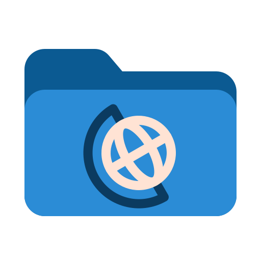

<p align="center">
  
</p>

<h1 align="center">Atlas</h1>

Atlas is a fast, lightweight Material Design 3 file manager built with Rust, Qt 6 and QML.

## Dependencies

### Build Dependencies (Required)

- Rust (stable toolchain) and Cargo
- A C++17 compiler (GCC or Clang) for the small native layer and cxx-qt's generated code
- Qt 6.5+ development packages, with `qmake6` on `PATH` (or `QMAKE` set):
  - `Qt6Core`
  - `Qt6Gui`
  - `Qt6Qml`
  - `Qt6Quick`

### Runtime Dependencies (Required)

- Qt 6 runtime libraries:
  - `qt6-declarative` / `qt6-qml`
  - `qt6-quickcontrols2`
  - `qt6-quickeffects`
  - `qt6-svg`
  - `qt6-multimedia`

### Optional Dependencies

- `udisks2`: external drive and partition detection, mounting, and unmounting
- `gvfs` and `gvfs-backends`: remote network filesystem mounting for SFTP, SMB, FTP, NFS, WebDAV
- `gio`: command-line URI mounting and volume management
- `xdg-utils`: default application launching via `xdg-open`
- `git`: inline repository status, branch tracking, and Git modal operations
- `ffmpeg`: media tools for video and audio (trim/clip, format conversion, rotate/flip), and `ffprobe` for audio and video details in the preview panel and properties dialog
- `imagemagick`: image conversion in the Media Tools menu (supports any readable format, including SVG, PDF, HEIC)
- `exiv2`: editing the EXIF comment of a photo in the properties dialog (reading EXIF needs nothing extra)
- `caelestia-cli`: dynamic color palette and accent syncing with Caelestia
- `papirus-icon-theme` and `papirus-folders`: dynamic folder color and system icon theme integration
- Archive tools: `p7zip`, `tar`, `gzip`, `bzip2`, `xz`, `zip`, `unzip` for archive extraction and compression

## Build Instructions

Atlas is written in Rust on Qt 6 through [cxx-qt](https://github.com/KDAB/cxx-qt). The QML,
fonts and assets are compiled into a single `atlas` binary.

```bash
# Build
cargo build --release

# Run file manager locally
./target/release/atlas
```

## Installation

```bash
# Build as your user first, then install the binary, its desktop entry and its icon
cargo build --release
sudo make install

# Or install to a custom prefix
make install PREFIX=~/.local
```

### Uninstallation

```bash
sudo make uninstall
```

## Documentation

Documentation for working on Atlas is in [docs/](docs/README.md).

## Credits and Licensing

This project is licensed under the GNU General Public License v3.0 (GPLv3).

Atlas incorporates design tokens, QML components, animations, and styling derived from [Caelestia Shell](https://github.com/caelestia-dots/shell). Heavy credit and gratitude go to the authors and contributors of Caelestia Shell for their work under the GPLv3 license.

